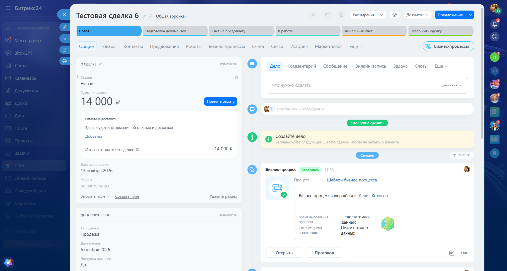
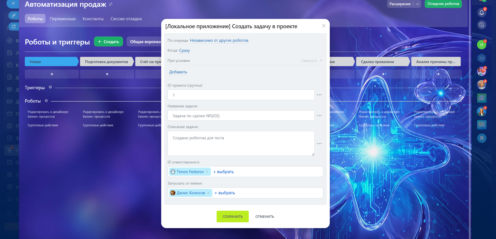
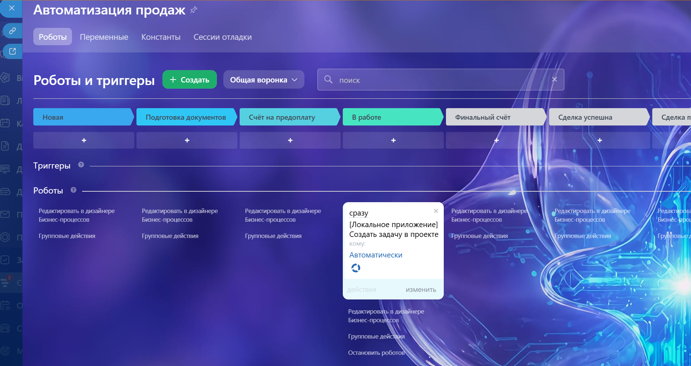
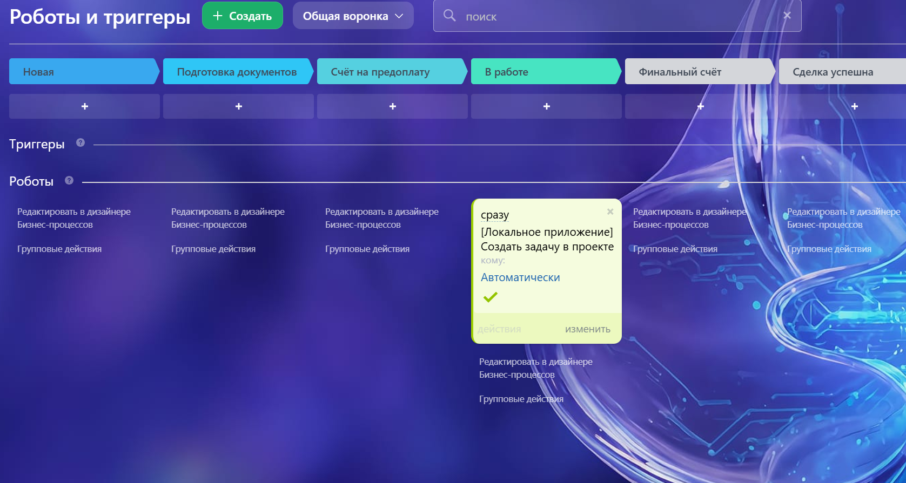
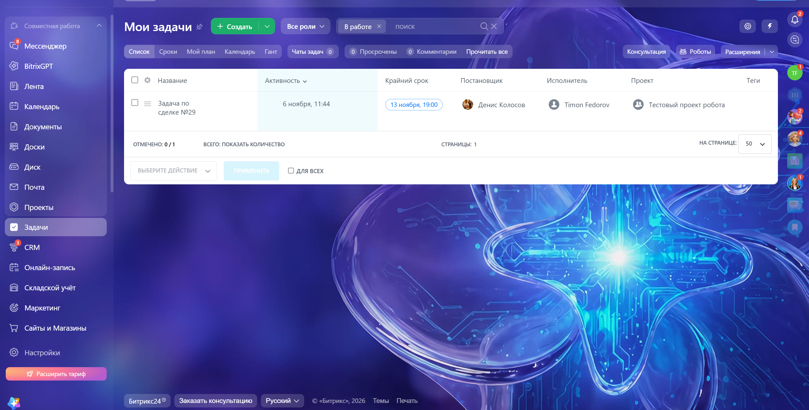

# 🤖 Bitrix24 Custom Robot — «Создать задачу в проекте»

Кастомный робот для бизнес-процессов Битрикс24, который при срабатывании в бизнес-процессе создаёт задачу в указанном проекте (группе) с заданным названием, описанием и ответственным, а затем возвращает ID созданной задачи обратно в процесс для дальнейших шагов.

Проект демонстрирует расширение платформы Битрикс24 за пределы «коробочных» возможностей: регистрацию собственного действия для бизнес-процессов, работу с REST API, событийной моделью и безопасным хранением токенов.

---

## 📋 Содержание

- [Зачем это нужно](#зачем-это-нужно)
- [Что умеет робот](#что-умеет-робот)
- [Архитектура](#архитектура)
- [Технологии](#технологии)
- [Установка](#установка)
- [Как это работает под капотом](#как-это-работает-под-капотом)
- [Безопасность](#безопасность)
- [Демонстрация](#демонстрация)
- [Какие навыки демонстрирует проект](#какие-навыки-демонстрирует-проект)
- [Возможные улучшения](#возможные-улучшения)

---

## Зачем это нужно

В реальных проектах на Битрикс24 часто возникают задачи, которые нельзя решить стандартными роботами и триггерами «из коробки». Например: создать задачу в конкретном проекте с привязкой к данным сделки, автоматически заполнить поля задачи шаблонами из карточки CRM, вернуть ID созданной задачи в бизнес-процесс для последующих действий.

Стандартные роботы Битрикс24 этого не позволяют. Кастомное действие для бизнес-процессов (робот) — штатный механизм платформы для таких сценариев, но требует понимания REST API, scope-модели, событийной модели и жизненного цикла локальных приложений.

## Что умеет робот

- 📌 Создаёт задачу в указанном **проекте (группе)** через REST API `tasks.task.add`
- 📝 Принимает **название, описание и ID ответственного** как входные параметры
- 🔗 Поддерживает **шаблоны подстановки** данных из документа бизнес-процесса (например, `{=Document:ID}`)
- 🔄 **Возвращает ID созданной задачи** в бизнес-процесс через `RETURN_PROPERTIES`
- 🛡️ Корректно завершает шаг процесса через `bizproc.event.send` — процесс не «зависает»
- 👤 Имеет **fallback на ответственного по умолчанию** (`AUTH_USER_ID`), если пользователь не указал его явно

## Архитектура

```
┌─────────────────┐     POST (HTTPS)     ┌──────────────────┐
│   Битрикс24     │ ───────────────────► │  robot_handler   │
│  (бизнес-процесс│                      │      .php        │
│   → робот)      │ ◄─────────────────── │                  │
└─────────────────┘   bizproc.event.send └────────┬─────────┘
        │                                         │
        │ OAuth (при установке)                   │ REST API
        ▼                                         ▼
┌─────────────────┐                       ┌──────────────────┐
│ install_handler │                       │  Битрикс24 REST  │
│      .php       │ ──► auth.json ──►     │  tasks.task.add  │
└─────────────────┘   (access_token)      └──────────────────┘
```

**Ключевые компоненты:**

| Файл | Назначение |
|------|-----------|
| `install_handler.php` | Installation callback. Принимает токены от Битрикс24 при установке/переустановке приложения и сохраняет их в `auth.json` |
| `register_robot.php` | Одноразовый скрипт регистрации робота через `bizproc.robot.add`. Читает `access_token` из `auth.json` |
| `robot_handler.php` | Основной обработчик. Принимает данные от Битрикс24, создаёт задачу через `tasks.task.add`, возвращает результат через `bizproc.event.send` |

## Технологии

- **PHP 8+** (cURL, JSON)
- **Bitrix24 REST API**: `tasks.task.add`, `bizproc.robot.add`, `bizproc.event.send`
- **Bitrix24 JS SDK** (для настройки приложения в портале)
- **ngrok** — для локальной разработки и публичного HTTPS-эндпоинта
- **OAuth 2.0** — Installation callback для получения токенов

## Установка

### 1. Клонирование репозитория

```bash
git clone https://github.com/your-username/bitrix24-custom-robot.git
cd bitrix24-custom-robot
```

### 2. Настройка конфигурации

Скопируйте `config.example.php` в `config.php` и заполните:

```php
<?php
return [
    'client_id'     => 'local.xxxxxxxxxxxx.xxxxxxxx',
    'client_secret' => 'xxxxxxxxxxxxxxxxxxxxxxxxxxxxxxxx',
    'portal_domain' => 'yourcompany.bitrix24.ru',
    'handler_url'   => 'https://your-ngrok-url.ngrok-free.dev/robot_handler.php',
    'install_url'   => 'https://your-ngrok-url.ngrok-free.dev/install_handler.php',
];
```

> ⚠️ `config.php` и `auth.json` добавлены в `.gitignore` и не должны попадать в репозиторий.

### 3. Создание локального приложения в Битрикс24

1. Перейдите в раздел **«Разработчикам»** → **«Другое»** → **«Локальные приложения»** → **«Добавить»**
2. Укажите:
   - **Название:** `Custom Robot — Create Task`
   - **URL приложения:** `https://your-ngrok-url.ngrok-free.dev/robot_handler.php`
   - **Путь для первоначальной установки:** `https://your-ngrok-url.ngrok-free.dev/install_handler.php`
   - **Опция «Приложение завершает установку самостоятельно»:** выключена (это важно!)
3. В блоке **«Настройка прав»** отметьте scope:
   - ✅ `bizproc` — регистрация действий/роботов
   - ✅ `tasks` — создание задач
   - ✅ `user` — работа с ответственными
4. Сохраните приложение. Вы получите `client_id` и `client_secret` — впишите их в `config.php`.

### 4. Запуск локального сервера и ngrok

```bash
# Терминал 1
php -S localhost:8000

# Терминал 2
ngrok http 8000
```

Скопируйте HTTPS-адрес из ngrok и обновите `handler_url` / `install_url` в `config.php` и в настройках приложения в Битрикс24.

### 5. Получение токенов через Installation callback

Переустановите приложение в Битрикс24 (удалить → создать заново). После сохранения Битрикс24 автоматически отправит POST-запрос на `install_handler.php`, который создаст `auth.json` с `access_token` и `refresh_token`.

Проверьте, что файл `auth.json` появился в корне проекта.

### 6. Регистрация робота

Откройте в браузере:

```
https://your-ngrok-url.ngrok-free.dev/register_robot.php
```

В ответе должно быть `"result":true`. После этого робот **«Создать задачу в проекте»** появится в дизайнере бизнес-процессов (вкладка «Действия приложений»).

### 7. Использование

1. Откройте сделку → вкладка **«Бизнес-процессы»** → создайте новый БП
2. Перетащите робота **«Создать задачу в проекте»** на схему
3. Заполните параметры:
   - **ID проекта (группы):** `45` (ID вашего проекта)
   - **Название задачи:** `Задача по сделке №{=Document:ID}`
   - **Описание задачи:** `Создано автоматически`
   - **ID ответственного:** `1` (или выберите пользователя)
4. Сохраните и запустите процесс → задача появится в указанном проекте

## Как это работает под капотом

### `bizproc.robot.add`

Регистрирует робота с флагом `USE_SUBSCRIPTION: 'Y'`. Это ключевой момент: такой робот **ждёт асинхронного ответа** от приложения через `bizproc.event.send`. Без этого вызова шаг бизнес-процесса зависнет навсегда.

```php
$robotParams = [
    'CODE'             => 'create_task_in_project',
    'HANDLER'          => $handlerUrl,
    'AUTH_USER_ID'     => 1,
    'USE_SUBSCRIPTION' => 'Y',  // ← ждёт ответа
    'NAME'             => ['ru' => 'Создать задачу в проекте'],
    'PROPERTIES'       => [
            [ProjectID] => 1
            [TaskTitle] => Задача по сделке №27
            [TaskDescription] => Создано роботом для теста
            [ResponsibleID] => user_19
    ],
    'RETURN_PROPERTIES'=> ['TaskID' => ['Type' => 'int']],
];
```

### `tasks.task.add`

Создаёт задачу с привязкой к проекту через `GROUP_ID`:

```php
$taskFields = [
    'TITLE'          => $taskTitle,
    'DESCRIPTION'    => $taskDesc,
    'RESPONSIBLE_ID' => (int)$responsibleId,
    'GROUP_ID'       => (int)$projectId,  // привязка к проекту
];
```

### `bizproc.event.send`

Завершает шаг процесса и возвращает значения в `RETURN_PROPERTIES`:

```php
$eventSendData = [
    'EVENT_TOKEN'   => $eventToken,      // из входящего запроса
    'RETURN_VALUES' => ['TaskID' => $taskId],
    'LOG_MESSAGE'   => "Успешно создана задача №{$taskId}.",
];
```

> **Важно:** `EVENT_TOKEN` приходит в теле входящего запроса и одноразовый. Если не вызвать `bizproc.event.send` с валидным токеном, процесс не завершится.

### Fallback ответственного

Поле `RESPONSIBLE_ID` иногда приходит пустым (если не заполнено в настройках робота). Обработчик проверяет три уровня:

1. `properties.ResponsibleID` (если число) → используем
2. `properties.ResponsibleID` (если массив) → берём первое значение
3. Если всё ещё `0` → `auth.user_id` (тот, от чьего имени запущен робот)

```php
$rawResponsible = $properties['ResponsibleID'] ?? null;
if (is_string($rawResponsible) && preg_match('/^user_/usi', $rawResponsible, $out)) {
    $rawResponsible = preg_replace('/^user_/usi', '', $rawResponsible);
}
if (is_array($rawResponsible)) {
    $rawResponsible = reset($rawResponsible);
}
$responsibleId = (int) $rawResponsible;
if ($responsibleId <= 0) {
    $responsibleId = (int) ($auth['user_id'] ?? 1);
}
```

## Безопасность

- ✅ **`client_secret` не используется в рантайме.** В обработчике `robot_handler.php` токен приходит от самого Битрикс24 в теле запроса (`auth.access_token`). `client_secret` нужен только на этапе установки/регистрации.
- ✅ **Токены хранятся в `auth.json`**, а не в коде. Файл добавлен в `.gitignore`.
- ✅ **Минимальные scope-права.** Приложение запрашивает только `bizproc`, `tasks`, `user`.
- ✅ **`EVENT_TOKEN` одноразовый.** Защищает от повторной обработки шага процесса.
- ⚠️ **Для production:** замените `auth.json` на хранение токенов в БД, добавьте refresh-token flow (`OAuth 2.0`), используйте постоянный HTTPS-домен вместо ngrok, добавьте проверку подписи запросов.

## Демонстрация

**Скриншот 1:** Создать Сделку в CRM


**Скриншот 2:** Робот «Создать сделку в проекте» в Роботах и триггерах




**Скриншот 3:** Созданная задача в тестовом проекте


## Какие навыки демонстрирует проект

| Навык | Где проявился |
|-------|---------------|
| **Расширение платформы Битрикс24** | Регистрация кастомного робота через `bizproc.robot.add` |
| **Работа с REST API** | `tasks.task.add`, `bizproc.event.send`, `bizproc.robot.add` |
| **Обработка событий бизнес-процессов** | `USE_SUBSCRIPTION: 'Y'`, `EVENT_TOKEN`, корректное завершение шага |
| **Scope-модель и безопасность** | Минимальные права (`bizproc`, `tasks`), `client_secret` только на установке |
| **OAuth 2.0 / Installation callback** | Безопасное получение токенов без хардкода секретов |
| **Понимание связей сущностей** | Сделка → задача → проект (`GROUP_ID`), fallback на `auth.user_id` |
| **Отладка в реальных условиях** | Разбор ошибки «Не указан исполнитель», логирование, `bizproc.event.send` |
| **Проектирование решения** | Проектирование параметров робота, выбор `USE_SUBSCRIPTION`, архитектура файлов |

## Возможные улучшения

- 🔄 **Refresh-token flow** — сейчас при истечении `access_token` робот перестанет работать. Нужно добавить обработчик `oauth.refresh` и cron для обновления.
- 🗄️ **Хранение токенов в БД** вместо `auth.json` — обязательно для production.
- 📎 **Добавление файла из карточки сделки** — можно расширить `tasks.task.add` через `UF_TASK_WEBDAV_FILES`.
- 🔗 **Привязка задачи к сделке** — через `tasks.task.add` с полем `UF_CRM_TASK` (`C_<dealId>`).
- 📊 **Дашборд** — показать, сколько задач создано роботом по проектам (логика из Идеи №1).
- 🧪 **Юнит-тесты** — вынести логику в отдельные функции и покрыть `PHPUnit`.

---

**Автор:** Денис · [@FTDen44](https://t.me/FTDen44), [ftforest640@gmail.com](mailto:ftforest640@gmail.com)

**Стек:** PHP · Bitrix24 REST API · BizProc · OAuth 2.0